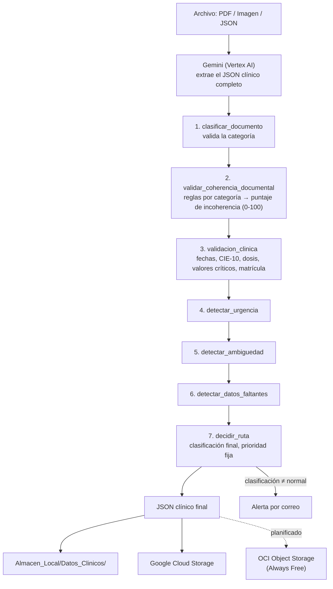

# Arquitectura — MediFlow

## Visión general

MediFlow recibe un documento clínico (PDF, imagen o JSON), lo procesa con Gemini (a través de Vertex AI) para extraer un JSON clínico estructurado y lo evalúa con un grafo de decisión en LangGraph, que combina reglas de coherencia documental y una validación clínica determinística para clasificar el documento y decidir si requiere revisión humana. El resultado se almacena localmente y en Google Cloud Storage, y los casos que requieren revisión generan una alerta por correo electrónico. El almacenamiento adicional en OCI Object Storage (Always Free) está planificado.

## Diagrama



## Categorías de documento

`Receta Médica` · `Informe de Estudio de Diagnóstico por Imágenes/Laboratorio` · `Orden de Solicitud de Procedimiento` · `Epicrisis / Informe de Alta` · `Certificado Médico` · `Otro`

## Evaluación del documento

El grafo evalúa cada documento en dos capas complementarias:

- **Coherencia documental.** Cada categoría cuenta con reglas de penalización configurables que suman puntos cuando el documento tiene datos incompletos o inconsistentes. La suma (0-100) es el puntaje de incoherencia, y tres umbrales configurables (por defecto 20 / 40 / 60) lo traducen en un nivel: `normal`, `revision`, `revision_prioritaria` o `alerta`.
- **Validación clínica determinística.** Sin invocar ninguna API, revisa con reglas y catálogos de referencia lo que Gemini extrajo: fechas, códigos CIE-10, medicamentos y dosis, valores críticos de laboratorio, formato de la matrícula profesional y documentos de doble propósito. Un valor crítico de laboratorio clasifica el documento como `urgente`; conflictos críticos o un puntaje clínico alto lo clasifican como `revision_clinica`.

Ninguno de los puntajes representa gravedad médica, diagnóstico ni probabilidad de enfermedad: son indicadores del flujo de trabajo para decidir qué nivel de revisión requiere el documento.

## Clasificación final

```
urgente > ambiguo > datos_faltantes > revision_clinica > alerta > revision_prioritaria > revision > normal
```

Una urgencia siempre tiene prioridad sobre el resto de las condiciones. Toda clasificación distinta de `normal` requiere revisión humana. Detalle de campos, reglas y estructura del JSON en [`contrato_datos.md`](contrato_datos.md).

## Componentes

| Componente | Función | Archivo |
|---|---|---|
| Configuración | Variables de entorno, cliente de Gemini en Vertex AI, rutas, extensiones permitidas; avisa si faltan variables | `Backend_MediFlow/configuracion.py` |
| Selección y guardado de archivo | Valida, renombra y guarda el archivo original | `Backend_MediFlow/archivos.py` |
| Extracción | Envía el archivo (como bytes, con su tipo MIME) a Gemini en Vertex AI y valida el JSON de respuesta | `Backend_MediFlow/gemini.py` |
| Umbrales | Umbrales configurables del puntaje de incoherencia | `Backend_MediFlow/umbrales.py` |
| Reglas | Reglas de penalización por categoría | `Backend_MediFlow/reglas.py` |
| Grafo de decisión | Los 7 nodos del diagrama | `Backend_MediFlow/langgraph_mediflow.py` |
| Validación clínica | Validaciones determinísticas contra catálogos de referencia | `Backend_MediFlow/validacion_clinica.py` |
| Catálogos de referencia | Subconjunto CIE-10, medicamentos, parámetros y valores críticos | `casos/referencia/catalogos/` |
| Almacenamiento local | Organiza y guarda el JSON final por clasificación | `Backend_MediFlow/almacenamiento.py` |
| Sincronización con la nube | Sube el archivo original y el JSON final a Cloud Storage | `cloud/sincronizar_almacenamiento.py`, `cloud/gcloud_storage.py` |
| Almacenamiento en OCI | Planificado: sincronización con OCI Object Storage (Always Free) | Por definir en `cloud/` |
| Notificaciones | Alerta por correo electrónico (SMTP de Gmail, cuentas dedicadas al proyecto) | `Backend_MediFlow/correo.py` |
| Interfaz | Aplicación web; importa el backend directamente | `Frontend/app_streamlit_backend.py` |

## Despliegue

Aplicación de un solo servicio, empaquetada en un contenedor Docker y desplegada en Google Cloud Run (`mediflow-service`, región `us-central1`). Gemini se consume a través de Vertex AI, con Google Cloud Storage como almacenamiento persistente y Secret Manager para los correos de las alertas. La rama `production` contiene los cambios necesarios para este despliegue (ver [`cambios_produccion.md`](cambios_produccion.md)). Detalle completo en [`infraestructura_cloud.md`](infraestructura_cloud.md).

### Autenticación y secretos

- **Sin API keys ni claves de cuenta de servicio.** En Cloud Run, el servicio corre con la cuenta de servicio `mediflow-backend` y las librerías de Google (Vertex AI y Cloud Storage) obtienen las credenciales automáticamente (Application Default Credentials). En desarrollo local se usan las credenciales personales (`gcloud auth application-default login`).
- **Correos de las alertas.** La cuenta de envío, la contraseña de aplicación y los destinatarios están en Secret Manager y llegan al servicio como variables de entorno (`EMAIL_USUARIO`, `EMAIL_PASSWORD`, `EMAIL_DESTINO`).
- **Permisos mínimos.** La cuenta de servicio solo tiene `roles/aiplatform.user` en el proyecto, `roles/storage.objectAdmin` sobre los tres buckets y `roles/secretmanager.secretAccessor` sobre los tres secretos.

## Historial de decisiones

| Decisión | Cambio |
|---|---|
| Semana 1 | Se reemplazó el plan original (Qwen2.5 + mDeBERTa en máquina virtual, vía PyTorch/Transformers) por Gemini + LangGraph, para reducir el riesgo de latencia en la CPU limitada de OCI Always Free y simplificar el pipeline (ya no hace falta un OCR aparte) |
| Plataforma de despliegue | OCI Compute (Ampere A1, Always Free) se descartó por falta de capacidad disponible; el despliegue pasó a Google Cloud Run con Google Cloud Storage |
| Estructura del servicio | Se pasó de dos servicios (backend FastAPI + frontend Streamlit) a uno solo: Streamlit importa el backend directamente. `Frontend_Respaldo/` conserva la versión anterior, sin uso activo |
| Acceso a Gemini | Se pasó de la API de Gemini con API key (Google AI Studio) a Gemini en Vertex AI, con las credenciales de la cuenta de servicio |
| Planificado | Almacenamiento en OCI Object Storage (Always Free) y correos dedicados al proyecto para las alertas |

