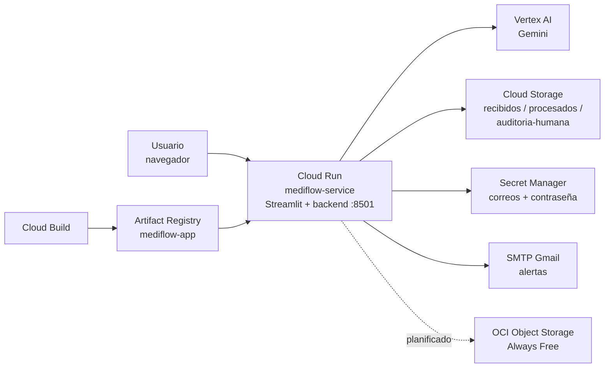

# Infraestructura Cloud — MediFlow

## Arquitectura de despliegue

MediFlow se despliega como un único servicio en **Google Cloud Run**, empaquetado con Docker. Gemini se consume a través de **Vertex AI**; el almacenamiento persistente utiliza **Google Cloud Storage**; las credenciales y los correos de las alertas se gestionan con **Secret Manager**; la imagen del contenedor se aloja en **Artifact Registry**. El almacenamiento en **OCI Object Storage (Always Free)** está planificado y aún no está implementado (ver [Almacenamiento en OCI](#almacenamiento-en-oci-always-free--planificado)).



| Servicio | Uso |
|---|---|
| Cloud Run | Ejecuta el contenedor (Streamlit + backend), puerto 8501. Servicio `mediflow-service` |
| Vertex AI | Gemini (`MODELO_GEMINI`, por defecto `gemini-2.5-flash`). El cliente usa la región `us-central1`, fija en el código |
| Cloud Storage | Tres buckets: `mediflow-recibidos`, `mediflow-procesados`, `mediflow-auditoria-humana` |
| Artifact Registry | Repositorio de imágenes Docker `mediflow-repo` |
| Cloud Build | Construcción de la imagen |
| Secret Manager | Cuenta de envío, destinatarios y contraseña de aplicación del correo de alertas |
| OCI Object Storage | Planificado (Always Free) |

La región de Cloud Run, la de los buckets y la que usa el cliente de Vertex AI es `us-central1`. Si se cambia una, hay que cambiar las demás.

> **Nota sobre el origen de los recursos.** Parte del entorno (los buckets, la cuenta de servicio y varios permisos) se creó originalmente desde la consola de Google Cloud. La guía de despliegue incluye todo como comandos, para poder reproducir el entorno desde cero.

## Almacenamiento

| Bucket | Contenido |
|---|---|
| `mediflow-recibidos` | Archivo original, al momento de la ingesta |
| `mediflow-procesados` | JSON clínico final de documentos con clasificación `normal` |
| `mediflow-auditoria-humana` | JSON clínico final de documentos que requieren revisión humana |

La sincronización entre el almacenamiento local y Cloud Storage la realiza `cloud/sincronizar_almacenamiento.py`, sobre el cliente definido en `cloud/gcloud_storage.py`. Comportamiento:

- La subida se ejecuta desde la interfaz web, al guardar el archivo original y al guardar el JSON final. El modo terminal (`Backend_MediFlow/main.py`) no sincroniza con Cloud Storage.
- Si la subida falla (por ejemplo, por falta de credenciales), el error se registra en el log y el procesamiento continúa con el almacenamiento local.
- Las acciones de conservar, mover o eliminar el JSON final desde la interfaz se aplican a la copia local; la copia en Cloud Storage no se modifica.
- En Cloud Run el disco local es efímero: la persistencia de los resultados la provee Cloud Storage.

## Identidad y permisos

La aplicación **no utiliza claves de cuenta de servicio**. En Cloud Run, las librerías de Google obtienen sus credenciales automáticamente a través de las Application Default Credentials (ADC); no se requiere archivo de clave ni la variable `GOOGLE_APPLICATION_CREDENTIALS`. Esto es compatible con la política de organización `iam.disableServiceAccountKeyCreation`, que impide la creación de claves y que viene activa por defecto en organizaciones nuevas.

### Cuenta de servicio de ejecución: `mediflow-backend`

Es la identidad con la que corre el servicio. Recibe solo lo que el código necesita:

| Rol | Alcance | Para qué |
|---|---|---|
| `roles/aiplatform.user` | Proyecto | Invocar Gemini en Vertex AI |
| `roles/storage.objectAdmin` | Solo los tres buckets | Subir objetos a los buckets |
| `roles/secretmanager.secretAccessor` | Solo los tres secretos | Leer los correos y la contraseña de las alertas |

### Identidad de construcción: cuenta de servicio de Compute por defecto

En proyectos nuevos, `gcloud builds submit` ejecuta la compilación con la cuenta de servicio de Compute Engine por defecto (`<NUMERO_DEL_PROYECTO>-compute@developer.gserviceaccount.com`). Para construir y publicar la imagen se le asignaron, a nivel de proyecto:

| Rol | Para qué |
|---|---|
| `roles/storage.objectAdmin` y `roles/storage.admin` | Acceder al código fuente que `gcloud builds submit` sube a Cloud Storage |
| `roles/logging.logWriter` | Escribir los registros de la compilación |
| `roles/artifactregistry.writer` | Publicar la imagen en Artifact Registry |

`roles/storage.admin` a nivel de proyecto es un permiso amplio. Una alternativa más acotada es `roles/cloudbuild.builds.builder` sobre esa misma cuenta; no se probó en este proyecto.

### Cuenta del equipo que construye y despliega

La cuenta propietaria del proyecto recibió además, de forma explícita, `roles/cloudbuild.builds.editor` (crear compilaciones) y `roles/serviceusage.serviceUsageConsumer` (usar las APIs habilitadas del proyecto).

### Otras identidades

- **En desarrollo local:** se utilizan las credenciales personales del desarrollador mediante `gcloud auth application-default login` (ver [Desarrollo local](#desarrollo-local)). Esa cuenta necesita `roles/aiplatform.user` en el proyecto, y permisos de lectura y escritura sobre los buckets si se desea sincronizar.
- **Workload Identity Federation** aplica a cargas de trabajo que se ejecutan *fuera* de Google Cloud (por ejemplo, un pipeline de despliegue continuo en GitHub Actions). No es necesaria para el servicio en Cloud Run.

## Variables de entorno

| Variable | Descripción | Origen en Cloud Run |
|---|---|---|
| `GCP_PROJECT_ID` | ID del proyecto de Google Cloud donde se usa Vertex AI | Variable de entorno |
| `MODELO_GEMINI` | Modelo de Gemini. Opcional: si se omite, el código usa `gemini-2.5-flash` | Variable de entorno |
| `EMAIL_USUARIO` | Cuenta de Gmail que envía las alertas | Secret Manager: `mediflow-origin-email` |
| `EMAIL_PASSWORD` | Contraseña de aplicación de esa cuenta de Gmail | Secret Manager: `mediflow-email-password` |
| `EMAIL_DESTINO` | Destinatario(s) de las alertas, separados por comas | Secret Manager: `mediflow-destinatary-email` |
| `GCS_BUCKET_RECIBIDOS` | Nombre del bucket de documentos recibidos | Variable de entorno |
| `GCS_BUCKET_HISTORIA_CLINICA` | Nombre del bucket de documentos de archivo | Variable de entorno |
| `GCS_BUCKET_URGENCIAS` | Nombre del bucket de documentos de urgencias | Variable de entorno |
| `GCS_BUCKET_FARMACIA` | Nombre del bucket de documentos de farmacia | Variable de entorno |
| `GCS_BUCKET_AUDITORIA_AUTORIZACIONES` | Nombre del bucket de documentos de autorizaciones | Variable de entorno |
| `GCS_BUCKET_REVISION_HUMANA` | Nombre del bucket de auditoría humana | Variable de entorno |

`GEMINI_API_KEY` **ya no se usa**: Gemini se autentica con la identidad de Google Cloud. Si existe un secreto con esa clave de una versión anterior de la guía (`mediflow-gemini-key`), no es necesario.

Si falta `GCP_PROJECT_ID` o alguna variable de correo, `Backend_MediFlow/configuracion.py` imprime un aviso `CONFIGURATION ERROR` en el log con el nombre de las variables que faltan; el programa no se detiene en ese punto.

## Correos de las alertas

Las alertas por correo utilizan cuentas **dedicadas al proyecto**, no cuentas personales. Las cuentas usadas durante las pruebas se reemplazarán por cuentas creadas para MediFlow.

| Valor | Variable | Secreto | Detalle |
|---|---|---|---|
| Cuenta de envío | `EMAIL_USUARIO` | `mediflow-origin-email` | Cuenta de Gmail con verificación en dos pasos |
| Contraseña de aplicación | `EMAIL_PASSWORD` | `mediflow-email-password` | Generada para MediFlow desde la cuenta de envío; no es la contraseña de acceso |
| Destinatario(s) | `EMAIL_DESTINO` | `mediflow-destinatary-email` | Una o varias cuentas separadas por comas |

Reglas de manejo:

- Los tres valores viven solo en Secret Manager. No se escriben en el repositorio, en la documentación ni en mensajes de chat; en el repositorio solo existe `.env.example`, sin valores.
- Para crear los secretos se usa `read -rs` (paso 6 de la guía), de modo que la contraseña no queda en el historial de la terminal.
- Cambiar una cuenta o la contraseña **no requiere cambios de código**: se agrega una versión nueva al secreto y se despliega una revisión nueva (ver [Actualizar un secreto](#actualizar-un-secreto)). Los secretos expuestos como variables de entorno se leen cuando arranca la instancia, por lo que una instancia en ejecución no ve el valor nuevo hasta que se crea una revisión.
- La lista de destinatarios se guarda en Cloud Storage (_configuracion/correos_destino.json) y persiste a los reinicios. EMAIL_DESTINO solo se usa como valor inicial la primera vez.

## Enlaces temporales en las alertas por correo

Cada alerta de revisión humana incluye un enlace de descarga del JSON clínico en cada nube. Los buckets de ambas nubes son **privados**: no se hacen públicos. Los enlaces se generan en el momento de enviar la alerta (`cloud/sincronizar_almacenamiento.py`), son de **solo lectura**, apuntan a **un único objeto** y **vencen**.

| Nube | Mecanismo | Función | Acceso que concede |
|------|-----------|---------|--------------------|
| Google Cloud Storage | URL firmada V4 (`GET`) | `generar_url_firmada()` en `cloud/gcloud_storage.py` | Descargar ese objeto |
| OCI Object Storage | Pre-Authenticated Request (PAR) tipo `ObjectRead` sobre un objeto | `generar_url_par()` en `cloud/oci_storage.py` | Descargar ese objeto |

La vigencia se controla con la variable `HORAS_VIGENCIA_ENLACES` (opcional; por defecto 2 horas). Si un enlace no se puede generar, el correo se envía igual y ese enlace aparece como "No disponible"; el motivo queda en el log (`No se pudo firmar la URL de GCS...` o `No se pudo generar el enlace (PAR) de OCI...`).

### Seguridad de los enlaces

- **Quien tenga el enlace puede descargar ese objeto** hasta que venza, sin iniciar sesión. Los enlaces viajan por correo: quien acceda a esa bandeja, o a un reenvío, puede abrirlos mientras estén vigentes.
- **Alcance mínimo.** Cada enlace da lectura de un solo objeto; no permite listar el bucket, subir, sobrescribir ni borrar.
- **Los buckets siguen cerrados.** En GCS se crean con `--uniform-bucket-level-access --public-access-prevention`; en OCI con `--public-access-type NoPublicAccess`. No hace falta hacer públicos los buckets para que los enlaces funcionen.
- **Vigencia.** Corta por diseño (2 h). En GCS, la firma V4 admite como máximo 7 días; en OCI la expiración es obligatoria y no tiene tope. Se recomienda no pasar de 24 h.
- **Revocación.** En OCI se revoca un enlace eliminando su PAR. En GCS una URL firmada no se puede revocar de forma individual: deja de funcionar al vencer, al borrar el objeto o al quitarle a la cuenta firmante el permiso de lectura.
- **Limpieza.** Los PAR de OCI vencidos siguen listados en el bucket hasta que se eliminan (consola de OCI o `oci os preauth-request`).
- **Datos reales.** Mientras la aplicación esté publicada con `--allow-unauthenticated`, solo deben procesarse documentos sintéticos. Con datos reales habría que revisar además el cuerpo del correo, que incluye el nombre del paciente y del médico.

### Permisos necesarios

**Google Cloud**

| Identidad | Recurso | Permiso / rol | Para qué |
|-----------|---------|---------------|----------|
| Cuenta de servicio de ejecución (`mediflow-backend`) | Los 6 buckets | `roles/storage.objectAdmin` | Subir los JSON y leerlos. El enlace firmado hereda los permisos de la cuenta que firma (necesita `storage.objects.get`) |
| `mediflow-backend` | La propia cuenta de servicio | `roles/iam.serviceAccountTokenCreator` (`iam.serviceAccounts.signBlob`) | **Solo Cloud Run.** Cloud Run no tiene llave privada, así que la firma se hace por IAM |
| Proyecto | — | API `iamcredentials.googleapis.com` habilitada | **Solo Cloud Run.** Es la API de IAM que realiza la firma |

- **Desarrollo local (Docker):** `GOOGLE_APPLICATION_CREDENTIALS` debe apuntar a la llave JSON de una **cuenta de servicio**; con ella la firma se calcula localmente. Las credenciales personales (`gcloud auth application-default login`) no pueden firmar URLs.
- **Cloud Run:** el código intenta firmar con llave y, si las credenciales solo traen un token (caso de Cloud Run), firma por IAM.
- El rol `serviceAccountTokenCreator` se otorga **sobre la propia cuenta de servicio**, no a nivel de proyecto.

**OCI**

| Identidad | Permiso | Para qué |
|-----------|---------|----------|
| Usuario de la API key de OCI | `PAR_MANAGE` sobre los buckets, más lectura de objetos | Crear los PAR |

Política sencilla que lo cubre (es amplia; se puede acotar):

```
Allow group <GRUPO_DEL_USUARIO_API> to manage object-family in compartment <NOMBRE_DEL_COMPARTMENT>
```

La llave privada del usuario de la API se entrega al servicio como archivo (Docker local) o desde Secret Manager (Cloud Run); nunca se versiona.

### Comandos

```bash
export PROYECTO="one-g10-mediflow-equipo50"
export SA_RUN="mediflow-backend@${PROYECTO}.iam.gserviceaccount.com"
export BUCKETS="mediflow-recibidos mediflow-historia-clinica mediflow-revision-humana mediflow-urgencias mediflow-farmacia mediflow-auditoria-autorizaciones"

# Lectura y escritura sobre los 6 buckets
for B in $BUCKETS; do
  gcloud storage buckets add-iam-policy-binding gs://$B \
    --member="serviceAccount:${SA_RUN}" --role="roles/storage.objectAdmin"
done

# Solo Cloud Run: firmar por IAM
gcloud services enable iamcredentials.googleapis.com --project=${PROYECTO}
gcloud iam service-accounts add-iam-policy-binding ${SA_RUN} \
  --member="serviceAccount:${SA_RUN}" --role="roles/iam.serviceAccountTokenCreator"

# Verificar que el rol quedó asignado
gcloud iam service-accounts get-iam-policy ${SA_RUN} \
  --flatten="bindings[].members" \
  --filter="bindings.role:roles/iam.serviceAccountTokenCreator" \
  --format="table(bindings.members)"
```

Después de cambiar permisos en Cloud Run no hace falta reconstruir la imagen; sí se necesita una revisión nueva si cambia el código (pasos 7 y 8 de la guía de despliegue).

### Solución de problemas de los enlaces

| Síntoma en el log o en el correo | Causa probable |
|----------------------------------|----------------|
| `you need a private key to sign credentials ... compute_engine ...` | Versión del código sin firma por IAM: actualizar `cloud/gcloud_storage.py` y desplegar una revisión nueva |
| Error 403 con `iam.serviceAccounts.signBlob` | Falta `roles/iam.serviceAccountTokenCreator` de `mediflow-backend` sobre sí misma |
| Error indicando que la API de IAM Service Account Credentials no está habilitada | Habilitar `iamcredentials.googleapis.com` |
| El enlace de GCS abre con "acceso denegado" o error de firma | La cuenta firmante no tiene lectura en ese bucket, o el enlace ya venció |
| `NotAuthorizedOrNotFound` al crear el PAR de OCI | Falta la política, o el nombre del bucket o del compartment no coincide (OCI usa el mismo error para ambos casos) |
| El correo muestra "No disponible" en un enlace | No se pudo generar ese enlace; revisar el log de esa nube |

## Guía de despliegue

Los comandos pueden ejecutarse desde **Cloud Shell** (consola de Google Cloud → ícono de terminal), que trae `gcloud` instalado y autenticado; en ese caso hay que clonar primero el repositorio allí y cambiar a la rama `production` (`git clone <url-del-repo>` y `git checkout production`). La imagen se construye en Cloud Build (paso 7), por lo que no se requiere Docker local.

### 0. Preparar la terminal

Solo si se trabaja desde una máquina local (macOS con Homebrew); en Cloud Shell no hace falta:

```bash
brew install --cask google-cloud-sdk
gcloud auth login
```

Definir las variables que usan los pasos siguientes (reemplazar los valores entre `< >`) y seleccionar el proyecto:

```bash
export PROYECTO="<ID_DEL_PROYECTO>"
export REGION="us-central1"
export MODELO="gemini-2.5-flash"
export SA="mediflow-backend@${PROYECTO}.iam.gserviceaccount.com"
export NUMERO_PROYECTO=$(gcloud projects describe ${PROYECTO} --format="value(projectNumber)")
export SA_BUILD="${NUMERO_PROYECTO}-compute@developer.gserviceaccount.com"

gcloud config set project ${PROYECTO}
```

### 1. Habilitar las APIs

```bash
gcloud services enable run.googleapis.com artifactregistry.googleapis.com \
  cloudbuild.googleapis.com secretmanager.googleapis.com storage.googleapis.com \
  aiplatform.googleapis.com
```

`aiplatform.googleapis.com` (Vertex AI) es necesaria porque el backend crea el cliente de Gemini con `vertexai=True`.

### 2. Crear los buckets

```bash
for BUCKET in mediflow-recibidos mediflow-historia-clinica mediflow-revision-humana \
              mediflow-urgencias mediflow-farmacia mediflow-auditoria-autorizaciones; do
  gcloud storage buckets create gs://${BUCKET} \
    --location=${REGION} \
    --uniform-bucket-level-access \
    --public-access-prevention
done
```

Los nombres de bucket son únicos a nivel global; si alguno ya está tomado por otro proyecto, hay que elegir otro y reflejarlo en `GCS_BUCKET_*` y en el resto de los pasos.

### 3. Crear la cuenta de servicio de ejecución y asignarle permisos

```bash
gcloud iam service-accounts create mediflow-backend \
  --display-name="MediFlow - ejecución en Cloud Run"

# Gemini en Vertex AI
gcloud projects add-iam-policy-binding ${PROYECTO} \
  --member="serviceAccount:${SA}" \
  --role="roles/aiplatform.user"

# Cloud Storage: solo sobre los buckets
for BUCKET in mediflow-recibidos mediflow-historia-clinica mediflow-revision-humana \
              mediflow-urgencias mediflow-farmacia mediflow-auditoria-autorizaciones; do
  gcloud storage buckets add-iam-policy-binding gs://${BUCKET} \
    --member="serviceAccount:${SA}" \
    --role="roles/storage.objectAdmin"
done
```

El permiso sobre los secretos se asigna en el paso 6, cuando los secretos ya existen.

### 4. Permisos para construir la imagen

Para la cuenta del equipo que construye y despliega (propietaria del proyecto):

```bash
gcloud projects add-iam-policy-binding ${PROYECTO} \
  --member="user:<CORREO_DE_LA_CUENTA_PROPIETARIA>" \
  --role="roles/cloudbuild.builds.editor"

gcloud projects add-iam-policy-binding ${PROYECTO} \
  --member="user:<CORREO_DE_LA_CUENTA_PROPIETARIA>" \
  --role="roles/serviceusage.serviceUsageConsumer"
```

Para la identidad con la que se ejecuta Cloud Build (ver [Identidad y permisos](#identidad-de-construcción-cuenta-de-servicio-de-compute-por-defecto)):

```bash
for ROL in roles/storage.objectAdmin roles/storage.admin \
           roles/logging.logWriter roles/artifactregistry.writer; do
  gcloud projects add-iam-policy-binding ${PROYECTO} \
    --member="serviceAccount:${SA_BUILD}" \
    --role="${ROL}"
done
```

En este proyecto también se asignó `roles/storage.admin` a la cuenta heredada `${NUMERO_PROYECTO}@cloudbuild.gserviceaccount.com`. Solo aplica si esa cuenta existe en el proyecto.

### 5. Crear el repositorio de imágenes

```bash
gcloud artifacts repositories create mediflow-repo \
  --repository-format=docker \
  --location=${REGION} \
  --project=${PROYECTO}
```

### 6. Guardar los secretos y dar acceso a la cuenta de servicio

Los valores se reemplazan por las cuentas dedicadas del proyecto. La contraseña se pide con `read -rs` para que no se muestre ni quede en el historial:

```bash
printf '%s' "<CORREO_DE_ENVIO>"  | gcloud secrets create mediflow-origin-email --data-file=-
printf '%s' "<CORREO_DESTINO>"   | gcloud secrets create mediflow-destinatary-email --data-file=-

read -rs EMAIL_PASSWORD     # pegar la contraseña de aplicación y presionar Enter
printf '%s' "${EMAIL_PASSWORD}" | gcloud secrets create mediflow-email-password --data-file=-
unset EMAIL_PASSWORD

for SECRETO in mediflow-email-password mediflow-origin-email mediflow-destinatary-email; do
  gcloud secrets add-iam-policy-binding "${SECRETO}" \
    --member="serviceAccount:${SA}" \
    --role="roles/secretmanager.secretAccessor"
done
```

Permisos Criptográficos para Alertas de Correo (URLs Firmadas)
Para que el backend de MediFlow pueda generar enlaces de descarga segura válidos por 2 horas sin exponer públicamente los buckets, la Cuenta de Servicio (SA) requiere el rol de creación de tokens sobre sí misma.
```bash
# Asignar rol de Creador de Tokens de Cuenta de Servicio a la SA de MediFlow
gcloud iam service-accounts add-iam-policy-binding \
    $SA \
    --member="serviceAccount:$SA" \
    --role="roles/iam.serviceAccountTokenCreator" \
    --project="$PROYECTO"
```

Para varios destinatarios, `<CORREO_DESTINO>` se escribe separado por comas.

### 7. Construir la imagen

Desde la raíz del repositorio (rama `production`):

```bash
gcloud builds submit \
  --tag ${REGION}-docker.pkg.dev/${PROYECTO}/mediflow-repo/mediflow-app:latest .
```

### 8. Desplegar en Cloud Run

```bash
gcloud run deploy mediflow-service \
  --image ${REGION}-docker.pkg.dev/${PROYECTO}/mediflow-repo/mediflow-app:latest \
  --region ${REGION} \
  --allow-unauthenticated \
  --port 8501 \
  --service-account ${SA} \
  --set-env-vars GCP_PROJECT_ID=${PROYECTO},MODELO_GEMINI=${MODELO},GCS_BUCKET_RECIBIDOS=mediflow-recibidos,GCS_BUCKET_PROCESADOS=mediflow-procesados,GCS_BUCKET_AUDITORIA=mediflow-auditoria-humana \
  --set-secrets EMAIL_USUARIO=mediflow-origin-email:latest,EMAIL_PASSWORD=mediflow-email-password:latest,EMAIL_DESTINO=mediflow-destinatary-email:latest
```

- `--port 8501` es necesario porque el `Dockerfile` ejecuta Streamlit en ese puerto (Cloud Run asume 8080 por defecto).
- `--allow-unauthenticated` publica la aplicación para la demostración: cualquiera con la URL puede usarla, y cada documento procesado consume cuota y costo de Vertex AI. En ese modo debe procesar únicamente documentos sintéticos.

### 9. Verificar

```bash
gcloud run services describe mediflow-service --region ${REGION} --format="value(status.url)"
gcloud run services logs read mediflow-service --region ${REGION} --limit 50
gcloud storage ls gs://mediflow-recibidos gs://mediflow-procesados gs://mediflow-auditoria-humana
```

Abrir la URL pública, procesar un documento de `casos/documents/` y confirmar que el archivo original y el JSON final llegaron a los buckets correspondientes. Los mensajes de sincronización y los avisos de configuración aparecen en los logs del servicio.

### Publicar una versión nueva

Tras cambiar el código en la rama `production`, se repiten los pasos 7 (construir) y 8 (desplegar).

### Actualizar un secreto

```bash
printf '%s' "<NUEVO_VALOR>" | gcloud secrets versions add mediflow-destinatary-email --data-file=-
```

Después hay que desplegar una revisión nueva de `mediflow-service` (por ejemplo, repitiendo el paso 8 o actualizando cualquier configuración del servicio), porque las instancias en ejecución conservan el valor con el que arrancaron. Para la contraseña de aplicación, primero se genera una nueva en la cuenta de Gmail de envío y se revoca la anterior.

## Revisar el estado de los permisos

Para confirmar que el entorno coincide con lo descrito en este documento:

```bash
# Roles de la cuenta de servicio de ejecución en el proyecto
gcloud projects get-iam-policy ${PROYECTO} --flatten="bindings[].members" \
  --filter="bindings.members:serviceAccount:${SA}" --format="table(bindings.role)"

# Roles de la identidad de construcción
gcloud projects get-iam-policy ${PROYECTO} --flatten="bindings[].members" \
  --filter="bindings.members:serviceAccount:${SA_BUILD}" --format="table(bindings.role)"

# Permisos sobre un bucket y sobre un secreto
gcloud storage buckets get-iam-policy gs://mediflow-recibidos
gcloud secrets get-iam-policy mediflow-email-password

# APIs habilitadas
gcloud services list --enabled | grep -E "run|artifactregistry|cloudbuild|secretmanager|storage|aiplatform"
```

## Solución de problemas

| Síntoma | Causa probable |
|---|---|
| `gcloud builds submit` falla por permisos sobre el código fuente, los logs o Artifact Registry | Falta alguno de los roles de la identidad de construcción (paso 4) |
| El servicio arranca, pero Gemini responde con error de permisos (403) o de API deshabilitada | Falta `roles/aiplatform.user` en `mediflow-backend` o la API `aiplatform.googleapis.com` (pasos 1 y 3) |
| El log muestra `CONFIGURATION ERROR` | Faltan variables de entorno o secretos en el despliegue (paso 8) |
| El log muestra avisos de «No se pudo sincronizar» | `mediflow-backend` no tiene `roles/storage.objectAdmin` sobre el bucket, o el nombre en `GCS_BUCKET_*` no coincide |
| Las alertas por correo no llegan | Contraseña de aplicación incorrecta o revocada, o secreto sin permiso para `mediflow-backend` (paso 6) |
| El servicio no responde en la URL | El servicio no escucha en 8501: falta `--port 8501` (paso 8) |

## Almacenamiento en OCI (Always Free) — planificado

**Estado: no implementado.** El código actual solo sincroniza con Google Cloud Storage; no existe un módulo de OCI en `cloud/`. El objetivo es cumplir el requisito del proyecto de usar Oracle Cloud Infrastructure, aprovechando la cuenta Always Free ya existente y su compartment dedicado al proyecto.

Alcance previsto (por confirmar con el equipo):

- Tres buckets equivalentes a los de Google Cloud (`recibidos`, `procesados`, `auditoria-humana`) en el compartment del proyecto.
- Mismo comportamiento que la sincronización actual: subir el archivo original y el JSON final, y ante un fallo registrar el error y continuar con el almacenamiento local.
- Un módulo en `cloud/` análogo a `gcloud_storage.py`, y una llamada adicional desde `cloud/sincronizar_almacenamiento.py`.
- El contrato de datos ya reserva el campo `almacenamiento_oci` (`bucket`, `ruta_objeto`) en el JSON de salida.

Puntos por decidir antes de implementarlo:

| Punto | Detalle |
|---|---|
| Rol de OCI | Espejo de Cloud Storage (se sube a ambos) o destino alterno |
| Autenticación desde Cloud Run | El SDK de OCI no usa las credenciales de Google: requiere credenciales propias de OCI. La opción directa es una clave de API de un usuario de OCI con una política mínima sobre el compartment, guardada en Secret Manager; sería la única integración que maneja una clave de larga duración. Conviene evaluar alternativas antes de adoptarla |
| Variables de entorno | Nombres propuestos: `OCI_BUCKET_RECIBIDOS`, `OCI_BUCKET_PROCESADOS`, `OCI_BUCKET_AUDITORIA`, más las credenciales de OCI que defina el punto anterior |
| Límites | Dentro de los límites del nivel Always Free. Los recursos Always Free se crean en la región de origen (*home region*) de la cuenta de OCI |
| Datos clínicos | Mismas reglas que en Google Cloud: solo documentos sintéticos mientras la aplicación sea pública |

OCI Compute (instancia Ampere A1) se evaluó como plataforma de despliegue y se descartó por falta de capacidad disponible; el despliegue se movió a Cloud Run.

## Almacenamiento en OCI (Always Free) — realizado

### 0. Preparar la terminal

Solo si se trabaja desde una máquina local (macOS con Homebrew); en Cloud Shell no hace falta:

```bash
brew install oci-cli

# Crear la carpeta .oci si no existe y asegurar permisos
mkdir -p ~/.oci && chmod 700 ~/.oci

# Generar la llave privada (Este es el archivo que va en la variable)
openssl genrsa -out ~/.oci/oci_api_key.pem 2048
chmod 600 ~/.oci/oci_api_key.pem

# Generar la llave pública y privada (Necesarias para el siguiente paso)
openssl rsa -pubout -in ~/.oci/oci_api_key.pem -out ~/.oci/oci_api_key_public.pem
```

Definir las variables que usan los pasos siguientes (reemplazar los valores entre `< >`) y seleccionar el compartimento:

```bash
# --- Variables de Oracle Cloud Infrastructure (OCI) ---
export OCI_COMPARTMENT_ID="<OCID_DEL_COMPARTMENT_DEL_PROYECTO>"
export OCI_NAMESPACE="<OBJECT_STORAGE_NAMESPACE_DE_TU_CUENTA>"
export OCI_REGION_PROP="sa-bogota-1" # Región de OCI Always Free

# Credenciales de API del usuario OCI para Secret Manager
export OCI_TENANCY_OCID="<OCID_DE_TU_TENANCY>"
export OCI_USER_OCID="<OCID_DE_TU_USUARIO_OCI>"
export OCI_FINGERPRINT="<FINGERPRINT_DE_LA_LLAVE_API>" # Se obtiene subiendo la clave pública en User Setting -> Tokens and keys -> API Keys
export RUTA_LLAVE_PEM="<RUTA_A_TU_ARCHIVO_LLAVE_PRIVADA_OCI.pem>"

# Escribir el archivo de configuración directamente usando tus variables
cat <<EOF > ~/.oci/config
[DEFAULT]
user=${OCI_USER_OCID}
fingerprint=${OCI_FINGERPRINT}
key_file=${RUTA_LLAVE_PEM}
tenancy=${OCI_TENANCY_OCID}
region=${OCI_REGION_PROP}
EOF
# Aplicar los permisos de seguridad obligatorios de Oracle
chmod 600 ~/.oci/config
```

Definir las variables que usan los pasos siguientes (reemplazar los valores entre `< >`) y seleccionar el proyecto:

### 1. Crear los buckets en OCI Object Storage

```bash
for BUCKET in mediflow-recibidos mediflow-historia-clinica mediflow-revision-humana \
              mediflow-urgencias mediflow-farmacia mediflow-auditoria-autorizaciones; do
  oci os bucket create \
    --name ${BUCKET} \
    --compartment-id ${OCI_COMPARTMENT_ID} \
    --region ${OCI_REGION_PROP}
done
```

### 2. Guardar los secretos y dar acceso 

```bash
printf '%s' "${OCI_TENANCY_OCID}" | gcloud secrets create oci-tenancy-ocid --data-file=-
printf '%s' "${OCI_USER_OCID}"    | gcloud secrets create oci-user-ocid --data-file=-
printf '%s' "${OCI_FINGERPRINT}"  | gcloud secrets create oci-fingerprint --data-file=-
printf '%s' "${OCI_NAMESPACE}"    | gcloud secrets create oci-namespace --data-file=-


# Cargar el archivo de la llave privada PEM multilínea de OCI de forma segura
gcloud secrets create oci-private-key-content --data-file="${RUTA_LLAVE_PEM}"

# Otorgar permisos de lectura (Accessor) a mediflow-backend sobre los nuevos secretos de OCI
for SECRETO in oci-tenancy-ocid oci-user-ocid oci-fingerprint oci-namespace oci-private-key-content; do
  gcloud secrets add-iam-policy-binding "${SECRETO}" \
    --member="serviceAccount:${SA}" \
    --role="roles/secretmanager.secretAccessor"
done
```
### 3. Despliegue definitivo en Cloud Run

```bash
gcloud run deploy mediflow-service \
  --image ${REGION}-docker.pkg.dev/${PROYECTO}/mediflow-repo/mediflow-app:latest \
  --region ${REGION} \
  --allow-unauthenticated \
  --port 8501 \
  --service-account ${SA} \
  --memory 1Gi \
  --set-env-vars GCP_PROJECT_ID=${PROYECTO},\
MODELO_GEMINI=${MODELO},\
OCI_REGION=${OCI_REGION_PROP},\
GCS_BUCKET_RECIBIDOS=mediflow-recibidos,\
GCS_BUCKET_HISTORIA_CLINICA=mediflow-historia-clinica,\
GCS_BUCKET_REVISION_HUMANA=mediflow-revision-humana,\
GCS_BUCKET_URGENCIAS=mediflow-urgencias,\
GCS_BUCKET_FARMACIA=mediflow-farmacia,\
GCS_BUCKET_AUDITORIA_AUTORIZACIONES=mediflow-auditoria-autorizaciones \
  --set-secrets EMAIL_USUARIO=mediflow-origin-email:latest,\
EMAIL_PASSWORD=mediflow-email-password:latest,\
EMAIL_DESTINO=mediflow-destinatary-email:latest,\
OCI_TENANCY_OCID=oci-tenancy-ocid:latest,\
OCI_USER_OCID=oci-user-ocid:latest,\
OCI_FINGERPRINT=oci-fingerprint:latest,\
OCI_NAMESPACE=oci-namespace:latest,\
OCI_PRIVATE_KEY_CONTENT=oci-private-key-content:latest
```


## Desarrollo local

Docker es opcional. Sin él, la aplicación se ejecuta dentro del ambiente de conda:

```bash
streamlit run Frontend/app_streamlit_backend.py
```

Con Docker:

```bash
docker compose up --build
```

La aplicación queda disponible en `http://localhost:8501`. Requisitos:

1. **Google Cloud CLI** y credenciales de Google Cloud. Desde que Gemini corre en Vertex AI, **son necesarios para ejecutar la aplicación**, no solo para sincronizar con los buckets. En macOS: `brew install --cask google-cloud-sdk`.
2. **Archivo `.env`** en la raíz del repositorio, creado a partir de `.env.example` (`docker-compose.yml` lo carga con `env_file`), con `GCP_PROJECT_ID` y las variables de correo completos.
3. **Docker Desktop en ejecución**, solo si se usa Docker.

Para autenticarse se usan las credenciales personales, sin claves de cuenta de servicio:

```bash
gcloud auth application-default login
```

La cuenta con la que se inicia sesión necesita `roles/aiplatform.user` en el proyecto y, para sincronizar, permisos de lectura y escritura sobre los tres buckets. Si Vertex AI responde con un error de proyecto de cuota (*quota project*), se resuelve con `gcloud auth application-default set-quota-project <ID_DEL_PROYECTO>`.

Al ejecutar sin Docker no se necesita nada más: la aplicación toma esas credenciales automáticamente. Al ejecutar con Docker, además, hay que crear en la raíz del repositorio un archivo `docker-compose.override.yml` **local** (no se versiona; Docker Compose lo combina automáticamente con `docker-compose.yml`):

```yaml
services:
  mediflow:
    environment:
      GOOGLE_APPLICATION_CREDENTIALS: /tmp/adc.json
    volumes:
      - ${HOME}/.config/gcloud/application_default_credentials.json:/tmp/adc.json:ro
```

En Windows, la ruta del archivo de credenciales es `%APPDATA%\gcloud\application_default_credentials.json`.

El volumen `./Almacen_Local:/app/Almacen_Local` de `docker-compose.yml` conserva los datos locales entre reconstrucciones del contenedor; esa persistencia es exclusiva del entorno local.